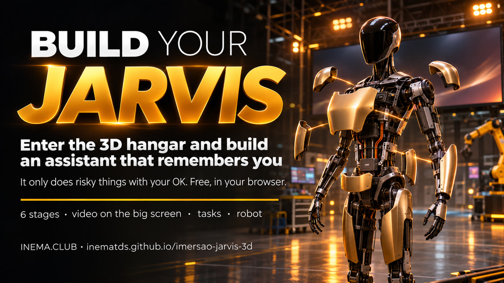

# Imersão Jarvis 3D

[](https://inematds.github.io/imersao-jarvis-3d/guia/en/)

**🇧🇷 [Português](README.md) · 🇺🇸 [English](README.en.md) · 🇪🇸 [Español](README.es.md)**

## What it is

Imersão Jarvis 3D is a free event that runs in your browser. It’s for people who use AI every day and want a personal assistant, called Jarvis here. You go through 6 stages in a hangar, a virtual 3D warehouse. Each stage has a video or other material, a task, and a clear sign that it’s complete. The journey leads to an assistant that remembers you and asks for your OK before taking a risky action. You can visit the event on a computer or phone, but the setup tasks are done on a computer. The event and videos are in Portuguese.

- **Enter the event:** https://eventos.inema.club/imersao-jarvis-3d/ (in Portuguese)
- **How it was made:** https://eventos.inema.club/imersao-jarvis-3d/processo/ (in Portuguese)
- **🎬 Video:** https://www.youtube.com/watch?v=zH75hEE2pzE (in Portuguese)

## 📖 User guide

Full guide: **https://inematds.github.io/imersao-jarvis-3d/guia/en/**

## Want to turn one of your pages into a place like this?

Open Claude Code or Codex in your project folder and paste this request:

```text
Read the project "Imersão Jarvis 3D" at https://github.com/inematds/imersao-jarvis-3d (start with the README) and see how it was made at https://eventos.inema.club/imersao-jarvis-3d/processo/.
Use this project only as a reference. Then look at my page in this project and answer in plain English:
1. What here could become stages, each with material, a task, and a clear sign that it’s "done"?
2. What would the person see progress at each stage?
3. Is it worth making this in 3D, or would a version without 3D work?
Don’t change anything yet. Show me the plan and wait for me to say yes.
```

---

## Technical installation

The event is a static website with no build step. You need Python 3 to serve the files and a browser with WebGL for 3D mode. Without WebGL, the event opens in 2D mode.

```bash
git clone https://github.com/inematds/imersao-jarvis-3d.git
cd imersao-jarvis-3d
python3 -m http.server 8791
```

Then open `http://localhost:8791/`.

To open it on other devices on your network, use the server that serves only public files:

```bash
python3 tools/servir.py <ip-da-maquina> 8791
```

### Files

| Path | What it contains |
|---|---|
| `index.html`, `src/` | The event: interface, 3D world, robot, controls, and progress |
| `conteudo/evento.json` | The schedule: stages, parts, materials, and text |
| `fonte/` | The source page, the single source of the content |
| `vendor/three/` | Three.js, without a CDN |
| `processo/` | The "How it was made" page, with requests, responses, revisions, and screenshots |
| `tools/` | Validator, local server, and run scripts |
| `guia/` | This guide in Portuguese, English, and Spanish |

### Tests

```bash
python3 tools/validar_conteudo.py
for f in src/*.js; do node --check "$f"; done
```

### Cost

`tools/resumir_rodada.py` records the time, tokens, and equivalent cost of each run in `processo/dados.json`. Actual use is through the Codex subscription, with no API key.

## The process, from start to finish

| Step | What happens | Command | Who does it |
|---|---|---|---|
| 1 | Copy the source page, logos, and Three.js | `fonte/`, `marca/`, `vendor/` | 🧠 session with Nei |
| 2 | Write the brief, rules, and validator | `processo/BRIEFING.md`, `tools/validar_conteudo.py` | 🧠 session with Nei |
| 3 | Write the schedule | `tools/rodar_codex.sh processo/prompts/01-conteudo.md` | 🤖 Codex Astra medium |
| 4 | Check the schedule against the source | `python3 tools/validar_conteudo.py` | ⚙️ script |
| 5 | Build the 3D hangar and the 2D mode | `tools/rodar_codex.sh processo/prompts/02-mundo.md` | 🤖 Codex Astra medium |
| 6 | Test in the browser and list fixes | browser + `processo/revisoes/` | 🧠 session with Nei |
| 7 | Apply the fixes | `tools/rodar_codex.sh processo/prompts/03-correcoes.md` | 🤖 Codex Astra medium |
| 8 | Polish the robot, lighting, and stages | `tools/rodar_codex.sh processo/prompts/04-acabamento.md` | 🤖 Codex Astra medium |
| 8b | Fix the starting robot and camera framing | `tools/rodar_codex.sh processo/prompts/04b-ajustes.md` | 🤖 Codex Astra medium |
| 9 | Create the "How it was made" page | `tools/rodar_codex.sh processo/prompts/05-processo.md` | 🤖 Codex Astra medium |
| 9b | Play the video on the stage screen | `tools/rodar_codex.sh processo/prompts/06-video-no-telao.md` | 🤖 Codex Astra medium |
| 10 | Final review and approval by Nei | `python3 -m http.server 8791` | 🧠 session with Nei |
| 11 | Publish the event on `eventos.inema.club` | `deploy/publicar.sh`, in the `eventos-inema-club` project | ⚙️ script |
| 12 | Write the guide and translate it into English and Spanish | `guia/`, `inema-traduz` | 🧠 session with Nei |
| 13 | Publish the guide and point the portal to it | `git push` + `atualiza-portal` skill | 🧠 session with Nei |
