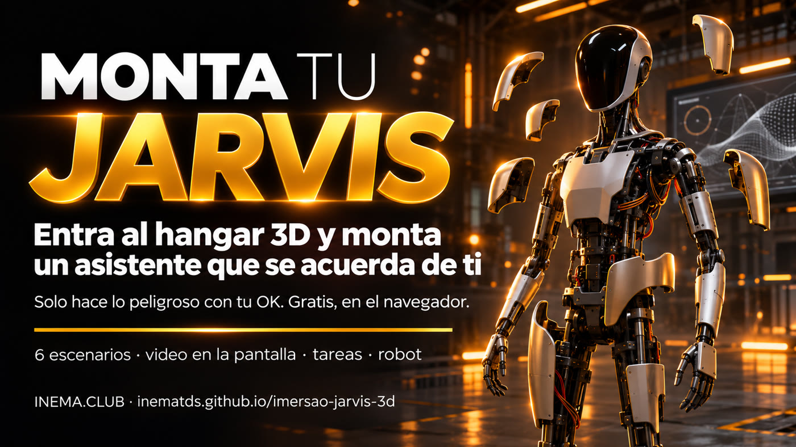

# Imersão Jarvis 3D

[](https://inematds.github.io/imersao-jarvis-3d/guia/es/)

**🇧🇷 [Português](README.md) · 🇺🇸 [English](README.en.md) · 🇪🇸 [Español](README.es.md)**

## Qué es

Imersão Jarvis 3D es un evento gratis que se abre en el navegador. Está pensado para quienes usan IA todos los días y quieren tener un asistente propio, llamado Jarvis en este caso. Recorres 6 etapas en un hangar, un espacio virtual en 3D. Cada etapa incluye un video o material, una tarea y una señal clara de que está completa. El recorrido te lleva a un asistente que te recuerda y pide tu OK antes de realizar una acción de riesgo. Puedes visitar el evento desde una computadora o un celular, pero las tareas de configuración se hacen en la computadora. El evento y los videos están en portugués.

- **Entrar al evento:** https://eventos.inema.club/imersao-jarvis-3d/ (en portugués)
- **Cómo se hizo:** https://eventos.inema.club/imersao-jarvis-3d/processo/ (en portugués)
- **🎬 Video:** https://www.youtube.com/watch?v=zH75hEE2pzE (en portugués)

## 📖 Guía de uso

Guía completa: **https://inematds.github.io/imersao-jarvis-3d/guia/es/**

## ¿Quieres convertir una página tuya en un lugar así?

Abre Claude Code o Codex en la carpeta de tu proyecto y pega esta solicitud:

```text
Lee el proyecto "Imersão Jarvis 3D" en https://github.com/inematds/imersao-jarvis-3d (empieza por el README) y revisa el proceso en https://eventos.inema.club/imersao-jarvis-3d/processo/.
Usa ese proyecto solo como referencia. Después revisa mi página en este proyecto y respóndeme en español sencillo:
1. ¿Qué partes podrían convertirse en etapas, cada una con material, una tarea y una señal clara de que está "lista"?
2. ¿Qué vería avanzar la persona en cada etapa?
3. ¿Vale la pena hacerlo en 3D o basta con una versión sin 3D?
Todavía no cambies nada. Muéstrame el plan y espera a que te diga que sí.
```

---

## Instalación técnica

El evento es un sitio estático, sin etapa de compilación. Necesitas Python 3 para servir los archivos y un navegador con WebGL para el modo 3D. Si no hay WebGL, el evento se abre en el modo sin 3D.

```bash
git clone https://github.com/inematds/imersao-jarvis-3d.git
cd imersao-jarvis-3d
python3 -m http.server 8791
```

Después, abre `http://localhost:8791/`.

Para abrirlo en otros dispositivos de la red, usa el servidor que sirve solo los archivos públicos:

```bash
python3 tools/servir.py <ip-da-maquina> 8791
```

### Archivos

| Ruta | Qué contiene |
|---|---|
| `index.html`, `src/` | El evento: interfaz, mundo 3D, robot, controles y progreso |
| `conteudo/evento.json` | La programación: escenarios, piezas, materiales y textos |
| `fonte/` | La página de origen, única fuente del contenido |
| `vendor/three/` | Three.js, sin CDN |
| `processo/` | La página "Cómo se hizo", con solicitudes, respuestas, revisiones y capturas |
| `tools/` | Validador, servidor local y ejecución de las rondas |
| `guia/` | Esta guía en portugués, inglés y español |

### Pruebas

```bash
python3 tools/validar_conteudo.py
for f in src/*.js; do node --check "$f"; done
```

### Costo

`tools/resumir_rodada.py` registra el tiempo, los tokens y el costo equivalente de cada ronda en `processo/dados.json`. El uso real es mediante la suscripción de Codex, sin clave de API.

## El proceso, de principio a fin

| Paso | Qué sucede | Comando | Quién lo hace |
|---|---|---|---|
| 1 | Copiar la página de origen, los logos y Three.js | `fonte/`, `marca/`, `vendor/` | 🧠 sesión con Nei |
| 2 | Escribir el brief, las reglas y el validador | `processo/BRIEFING.md`, `tools/validar_conteudo.py` | 🧠 sesión con Nei |
| 3 | Crear la programación | `tools/rodar_codex.sh processo/prompts/01-conteudo.md` | 🤖 Codex Astra medio |
| 4 | Revisar la programación con la fuente | `python3 tools/validar_conteudo.py` | ⚙️ script |
| 5 | Construir el hangar 3D y el modo sin 3D | `tools/rodar_codex.sh processo/prompts/02-mundo.md` | 🤖 Codex Astra medio |
| 6 | Probar en el navegador y anotar las correcciones | navegador + `processo/revisoes/` | 🧠 sesión con Nei |
| 7 | Aplicar las correcciones | `tools/rodar_codex.sh processo/prompts/03-correcoes.md` | 🤖 Codex Astra medio |
| 8 | Dar los últimos detalles al robot, la luz y los escenarios | `tools/rodar_codex.sh processo/prompts/04-acabamento.md` | 🤖 Codex Astra medio |
| 8b | Corregir el robot inicial y los encuadres | `tools/rodar_codex.sh processo/prompts/04b-ajustes.md` | 🤖 Codex Astra medio |
| 9 | Crear la página "Cómo se hizo" | `tools/rodar_codex.sh processo/prompts/05-processo.md` | 🤖 Codex Astra medio |
| 9b | Reproducir el video en la pantalla del escenario | `tools/rodar_codex.sh processo/prompts/06-video-no-telao.md` | 🤖 Codex Astra medio |
| 10 | Revisión final y aprobación de Nei | `python3 -m http.server 8791` | 🧠 sesión con Nei |
| 11 | Publicar el evento en `eventos.inema.club` | `deploy/publicar.sh`, en el proyecto `eventos-inema-club` | ⚙️ script |
| 12 | Escribir la guía y traducirla al inglés y al español | `guia/`, `inema-traduz` | 🧠 sesión con Nei |
| 13 | Publicar la guía y dirigir el portal hacia ella | `git push` + skill `atualiza-portal` | 🧠 sesión con Nei |
